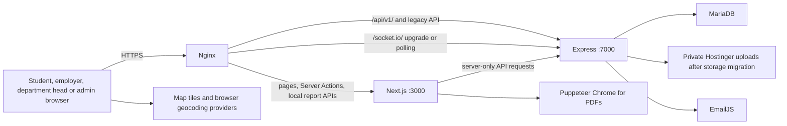

# Requirements and architecture

## Required for the current feature set

| Item | Purpose |
| --- | --- |
| Hostinger VPS with administrator access | Runs the two persistent Node applications. Confirm the plan is VPS hosting and inspect its selected OS template. |
| Node.js 24.x, at least 24.22.3, and npm | Both manifests currently require >=24.22.3 <25. Use a patched release within that range. |
| Linux dependencies installed on the VPS | npm installs platform-specific Sharp, SWC and browser dependencies. Install fresh from lockfiles. |
| Next.js production build and persistent frontend process | Server Actions, authentication and PDF API routes require a Node server. |
| Persistent Express process | APIs, Socket.IO, job execution and queue draining run in server.js. |
| MariaDB-compatible database and complete application schema | The current application uses mysql2 and MariaDB features, transactions and named locks. |
| Private persistent VPS uploads and an adapted storage backend | Selected deployment target. The current code still requires Supabase until the storage migration is implemented and verified. See chapter 09. |
| EmailJS service, account template, duty-reminder template and working credentials | Needed for onboarding, recovery and Sunday reminders. |
| Domain, DNS and HTTPS | Required for production secure cookies and phone camera/location use. |
| Reverse proxy and automatic process supervision | Nginx and systemd are the choices used in this guide. |
| Browser runtime for report exports | The VPS branch uses Puppeteer's downloaded Chrome and Linux libraries. |
| Backups, restores and a named operator | Cover database, storage objects, protected environment values and release versions. |

Start planning around 2 vCPU and 4 GB RAM for light use, preferably more memory when MariaDB and builds share the VPS. These are engineering estimates, not a measured capacity guarantee. Test realistic concurrent attendance, uploads and PDF exports. Disk allocation must include releases, dependencies, Chromium, logs, database and backups. Monitor actual consumption before committing a semester's workload.

## Optional or conditional

| Tool | When to use it |
| --- | --- |
| PM2 | Alternative process supervisor if the school already operates it. Use one process per app initially. |
| Docker / Compose | Optional packaging approach requiring its own reviewed image, Chrome sandbox and secret configuration. |
| Redis | Would require application changes for shared caches/socket coordination. It is absent from the current runtime requirement. |
| CDN / Cloudflare | Optional; review proxy trust, uploads, streaming and cache rules first. Start with DNS-only records. |
| Remote database | Allowed only with secure network transport and a schema-compatible MariaDB service. |
| VPS snapshots | Helpful for recovery, alongside database/storage backups and restore testing. |
| CI/CD and external uptime monitoring | Recommended once the initial manual deployment is validated. |
| Control panel | Optional. Its existing web server and firewall configuration may conflict with this guide's fresh Nginx setup. |

## Traffic and services

The diagram shows the selected target. Its local-storage connection requires the chapter 09 application changes before deployment.

Use https://eu-connect.example.edu as the single public origin in the examples. The backend CLIENT_URL must exactly match it, without a trailing slash. NEXT_PUBLIC_SOCKET_URL is the public HTTPS origin; API_BASE_URL is the private backend HTTP URL including /api/v1.

Start with one backend instance. Caches and socket delivery are process-local, and scheduled jobs start per process. Some jobs use database locks, while others require additional coordination before scaling. Clustering is a separate engineering change.

